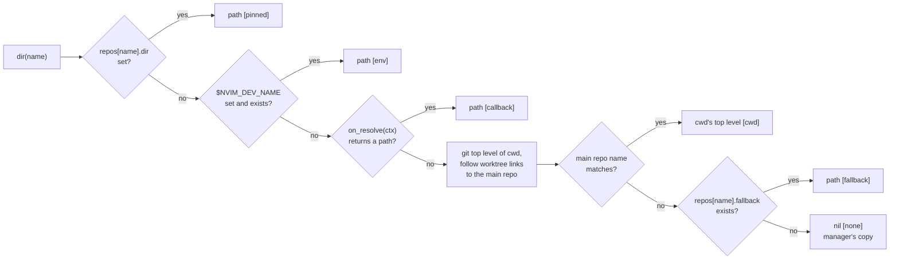

# devwhere.nvim

Decide whether a local checkout of a repository should be loaded instead
of the copy your plugin manager installed, and where it is.

When you develop Neovim plugins, your plugin manager installs its own copy
of every plugin. Existing managers support a fixed dev directory, but they
cannot answer the more useful question: which copy of this repo am I
actually standing in right now?

devwhere answers that question. It is manager agnostic and does exactly
one thing: given a repo name, return the path of the checkout you should
use, or nil when there is nothing special going on. It never touches the
runtimepath and never talks to your plugin manager.

## Installation

devwhere must be loadable before your plugin manager evaluates specs, so
it has to be on the runtimepath up front. The clone location is arbitrary;
the only requirements are that the clone exists when Neovim starts and
that its path is prepended before your plugin manager's setup call:

```lua
-- at the top of your config, before your plugin manager's setup
local dw = vim.fn.stdpath("data") .. "/devwhere.nvim"
if not vim.uv.fs_stat(dw) then
  vim.fn.system({
    "git", "clone", "--filter=blob:none",
    "https://github.com/williambdean/devwhere.nvim", dw,
  })
end
vim.opt.rtp:prepend(dw)
```

There is nothing to install after that; the module is ~200 dependency-free
lines and evaluates instantly.

Where the clone lives is up to you. If you use lazy.nvim, cloning into
`stdpath("data") .. "/lazy/devwhere.nvim"` keeps it in the `:Lazy` UI, and
listing devwhere in your lazy spec as well is harmless and keeps updates
visible, but it is not what makes the require work. Managers that install
git clones for you cannot install devwhere for you, since the require
happens before they run.

## How it resolves

Given `require("devwhere").dir("octo.nvim")`, the first match wins:

1. **Static pin**: `repos["octo.nvim"].dir` in the config, when set
2. **Env override**: `$NVIM_DEV_OCTO_NVIM`, when set and the path exists
3. **Callback**: `on_resolve(ctx)` returns a path, when configured
4. **Current directory**: when the working directory belongs to a checkout
   or worktree of that repo, that directory wins. Worktrees are found by
   following git's own worktree link, so they work no matter where they
   live, inside the repo or in `/tmp`
5. **Per-repo fallback**: `repos[name].fallback`, a canonical checkout for
   private repos that have no published copy to fall back to
6. **nil**: nothing special here. The meaning of nil depends on your
   manager wiring, but the intent is always "use the manager's installed
   copy like devwhere was never involved"

The same path, visually. (`repos[name].detect = false` skips the cwd
branch entirely.)



## Usage

Setup is fully optional; everything below is sugar:

```lua
require("devwhere").setup {
  notify = true, -- tell me when cwd detection picks a copy
  repos = {      -- per-repo overrides and the :DevStatus registry
    -- ["octo.nvim"] = {
    --   dir = "~/somewhere/else", -- static pin
    --   detect = false,           -- never use cwd for this repo
    --   repo_name = "octo",       -- when dir names differ from plugin names
    --   fallback = "~/src/octo",  -- canonical checkout for private repos
    -- },
  },
  on_resolve = nil, -- fun(ctx): string?, the escape hatch
}
```

The resolver is a plain function:

```lua
require("devwhere").dir "octo.nvim"   -- path or nil
require("devwhere").status "octo.nvim" -- same answer plus provenance
```

`status` returns the answer and why:

```lua
{ name = "octo.nvim", repo_name = "octo.nvim",
  dir = ".../octo.nvim/worktrees/extensibility",
  source = "cwd", repo = ".../octo.nvim" }
-- source is "pinned", "env", "callback", "cwd", or "none"
```

Commands:

```vim
:DevDir octo.nvim   " print the resolved path
:DevStatus octo.nvim " print the resolved path and why
:DevStatus          " audit every repo registered in repos
```

## Wiring it into your plugin manager

The glue is one expression per manager, and it lives in your config, not
in this plugin.

### lazy.nvim

Wire it once in your setup, and dev plugins need nothing special:

```lua
require("lazy").setup(spec, {
  dev = {
    -- plugins opt in via dev = true, or via a pattern match
    patterns = { "octo.nvim" },
    path = function(plugin)
      -- nil means nothing special: return a path that will never exist,
      -- so lazy's fallback installs and loads the plugin normally
      return require("devwhere").dir(plugin.name)
        or "/devwhere-none/" .. plugin.name
    end,
    fallback = true,
  },
})
```

Then a plain spec gets the behavior:

```lua
{ "pwntester/octo.nvim" }
```

Open Neovim in the repo root or any of its worktrees and lazy loads that
copy; open it anywhere else and lazy uses its own installed copy. Users
who never cloned the repo simply get the git-fetched version, always.

### vim.pack

vim.pack manages only the git clones in its own directory, so a local dev
copy bypasses it entirely:

```lua
local dir = require("devwhere").dir "octo.nvim"
if dir then
  -- load the checkout, and omit this plugin from vim.pack.add()
  vim.opt.rtp:prepend(dir)
end
```

## Notes

- Resolution happens once, when your config evaluates the spec. Changing
  worktrees mid-session does not re-resolve; restart to pick up the copy
  belonging to the new directory.
- Per-repo env overrides use the repo name uppercased with dots and dashes
  replaced by underscores: `octo.nvim` becomes `NVIM_DEV_OCTO_NVIM`.
- Path comparison is case insensitive, so case differences between the
  config root and the real path (common on macOS) do not break matching.

## Requirements

- Neovim 0.10 or newer
- No dependencies

## License

MIT
